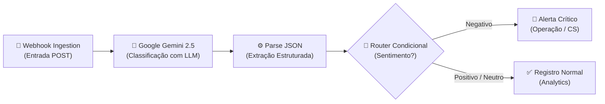

# 🍔 Delivery AI Triage — Pipeline de Análise de Feedbacks com IA

Pipeline de automação orientado a eventos (*event-driven*) e triagem inteligente de avaliações de clientes para plataformas de delivery (ex: iFood), utilizando **Make.com**, **Google Gemini 2.5 Flash** e **Webhooks**.

---

## 🎯 Problema de Negócio & Solução

* **Problema:** Em plataformas de delivery de alto volume, milhares de avaliações são enviadas diariamente. Feedbacks críticos de clientes insatisfeitos (comida fria, atrasos graves, pedidos errados) correm o risco de se perder no volume, causando churn e insatisfação.
* **Solução:** Um fluxo automatizado que captura avaliações em tempo real via Webhook, processa com LLM (Gemini) gerando um JSON estruturado com sentimento, urgência e ação sugerida, e roteia condicionalmente alertas imediatos para a equipe de operações.

---

## 🏗️ Arquitetura do Fluxo




### Componentes Técnicos
1. **Webhook Personalizado (Make):** Endpoint HTTP POST assíncrono para recepção dos dados do pedido (cliente, nota, pedido_id, feedback textual).
2. **Google Gemini 2.5 Flash:** Modelo de linguagem acionado com *system prompt* estrito para geração exclusiva de JSON válido contendo:
   * `sentimento`: positivo, neutro ou negativo.
   * `categoria`: entrega, qualidade_comida, atendimento, app, preco ou outro.
   * `urgencia`: alta, media ou baixa.
   * `resumo`: síntese concisa do problema.
   * `acao_sugerida`: plano de ação operacional recomendado.
3. **Módulo Parse JSON:** Desserialização da resposta do modelo em estrutura de dados nativa do Make.
4. **Router com Filtros de Texto:** Avaliação lógica do sentimento para direcionamento operacional.
5. **Webhook Response (Dual Branch):** Devolução formatada com códigos de status HTTP 200 e payload adaptado ao nível de criticidade.

---

## 🧪 Testes e Validação em Tempo Real

### 1. Simulação de Feedback Crítico (PowerShell)

```powershell
$url = "SUA_URL_WEBHOOK_MAKE"
$body = @{
    cliente   = "Maria Silva"
    pedido_id = "PED-2024-001"
    nota      = 1
    Feedback  = "Pedido chegou 2 horas atrasado, comida fria e o entregador foi super grosso!"
} | ConvertTo-Json

Invoke-RestMethod -Uri $url -Method Post -Body $body -ContentType "application/json"
```

**Retorno do Pipeline:**
```text
🚨 ALERTA DE FEEDBACK NEGATIVO 🚨

• Sentimento: negativo
• Categoria: entrega
• Urgência: alta
• Resumo: Cliente Maria Silva avaliou o pedido com nota 1/5 relatando atraso e mau atendimento.
• Ação: Entrar em contato proativo com a cliente Maria Silva para investigar o histórico do pedido.
```

---

### 2. Simulação de Feedback Positivo (PowerShell)

```powershell
$url = "SUA_URL_WEBHOOK_MAKE"
$body = @{
    cliente   = "João Santos"
    pedido_id = "PED-2024-002"
    nota      = 5
    Feedback  = "Entrega super rápida, comida quentinha e o entregador muito educado!"
} | ConvertTo-Json

Invoke-RestMethod -Uri $url -Method Post -Body $body -ContentType "application/json"
```

**Retorno do Pipeline:**
```text
✅ FEEDBACK REGISTRADO COM SUCESSO ✅

• Sentimento: positivo
• Categoria: entrega
• Resumo: Cliente elogiou a rapidez na entrega e qualidade da comida.
```

---

## 🛠️ Tecnologias Utilizadas

* **Automação & Low-Code:** [Make.com](https://make.com)
* **Inteligência Artificial Generativa:** Google Gemini (Gemini 2.5 Flash)
* **Arquitetura & Integração:** Webhooks, REST, HTTP POST, Event-Driven
* **Estruturação de Dados:** JSON Schema & Data Parsing
* **Testes & Scripts:** PowerShell (`Invoke-RestMethod`)

---

## 👨‍💻 Autor

**Pedro Dórea de Almeida**  
* Estudante de Análise e Desenvolvimento de Sistemas
* [LinkedIn](https://linkedin.com/in/pedrodorea) • [GitHub](https://github.com/pedrodoreaa)
